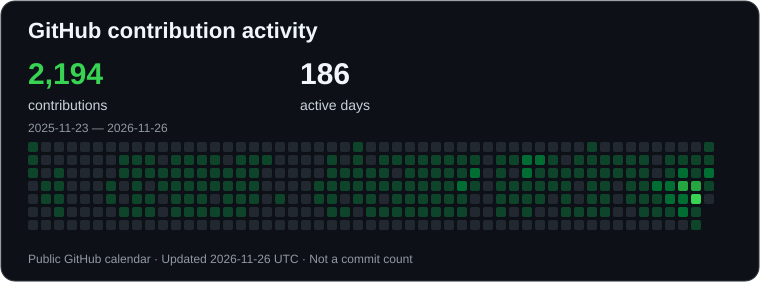

# Hi, I'm Ankit 👋

**Founding AI Engineer at SUMM AI · Munich, Germany**

I build production AI systems: LLM agents, retrieval-augmented generation (RAG), memory and evaluation pipelines. I work across research, engineering and product delivery—from the first experiment to deployment and monitoring.

Previously, I worked on applied AI research at **DFKI** and enterprise software at **JPMorgan Chase**. I hold an **MSc in Data Science and Artificial Intelligence from Saarland University**.

## What I work on

- **LLM applications:** tool calling, agent orchestration, memory and grounded answers.
- **Retrieval:** dense and hybrid search, document pipelines and retrieval evaluation.
- **Reliable AI:** automated evaluations, observability, and quality, latency and cost trade-offs.
- **Applied ML:** NLP, computer vision, graph neural networks and model fine-tuning.

**Tools I use:** Python, PyTorch, Hugging Face, LangChain, LangGraph, LiteLLM, FastAPI, Django, PostgreSQL, Docker, Kubernetes, AWS and GCP.

## Let's connect

Open to conversations about applied AI, research and collaboration.

## GitHub activity

Updated daily from GitHub's publicly visible contribution calendar. Contributions are not the same as commits; private work is represented only to the extent GitHub makes aggregate activity public. This is not a measure of my full professional work or language usage.

[Explore my public repositories →](https://github.com/ankitagr01?tab=repositories)
